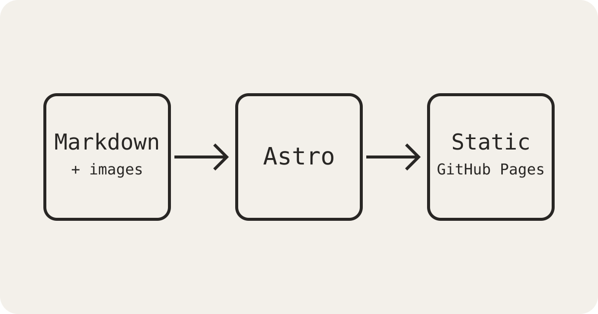

这是 `muzinian.github.io` 的第一篇文章。它同时也是一个最小的内容能力测试。

## 数学公式

行内公式 $e^{i\pi}+1=0$ 和块级公式都由 KaTeX 渲染：

$$
\int_{-\infty}^{\infty} e^{-x^2}\,dx = \sqrt{\pi}
$$

## 代码高亮

```ts
interface Post {
  title: string
  published: Date
}

const latest = (posts: Post[]) =>
  posts.toSorted((a, b) => b.published.getTime() - a.published.getTime())[0]
```

## 本地图片



图片使用标准 Markdown 相对路径引用，日后可以用脚本批量迁移到 R2、Cloudinary 或 OSS。
